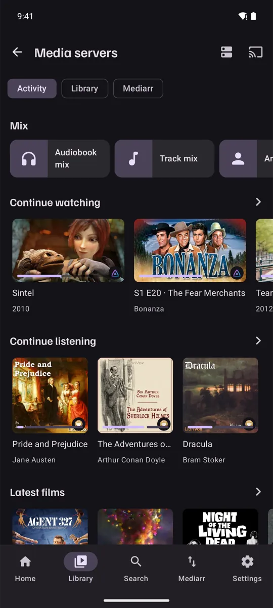

<p align="center">
  
</p>

<h1 align="center">Mediagg — landing page</h1>

<p align="center">
  <a href="https://mediagg.app">mediagg.app</a>
</p>

The marketing site for Mediagg, an app that plays the music, podcasts and video on your phone and
your TV, from your own media server and across the web — and casts any of it to Chromecast or DLNA.
Free to use.

**Android ships, on the phone and on the TV.** The app is one Kotlin Multiplatform codebase with four
shells: Android phone, Android TV, iPhone and Apple TV. Both Android apps are on Google Play under
one listing, `app.mediagg` (the phone's `playFull` build and `:app-android-tv` share the
applicationId; the TV's versionCode counts from 1000), so the site has one install link:
https://play.google.com/store/apps/details?id=app.mediagg. It is a new listing, not the old
`com.mbogimusic` one. The iPhone and Apple TV apps build and run but are not on the App Store, so the
site calls them on the way, with no date, and never tells anyone they can install them. Anything
firmer would be the site promising a listing that does not exist.

**This repository holds the website, not the app.** The app is not open source and its source is not
here, and the site links no APK downloads — Google Play is the only install link. The badge is
Google's own (`public/icons/google-play-badge.png`, unaltered), and the footer carries Google's
trademark line wherever it appears.

## What is here

| Path | |
|---|---|
| `public/` | The site. Home, privacy, `m3ugoat/`, 404, three `deeplink/` pages for links the old app generated (the current app has no `/deeplink/` intent filter, so these links always land here, and the pages say so), and two redirect stubs at `/full` and `/personal` — plus the screenshots and icons. This is what gets deployed. |
| `public/screens/tv/` | The TV section's captures: Android TV screens at 1600×900 (scaled from the 3840×2160 store captures in `../mediagg_store_screenshots/2026-10-14/story-source/img/v/`) and the phone's Add from phone checklist at 539×1200 (from `img/p/`). Opaque frames, so the page draws a TV set around them — unlike the cut-out phone renders. |
| `public/screens/` | The twelve carousel screenshots at 540×1202, with full-size 1344×2992 twins in `large/` for the enlarged view; the hero reuses three of them. Captures of the current Android app; see below. |
| `public/icons/` | `mediagg.png`, the launcher icon, and `og.png` for link previews. `mediagg-personal.png` is the retired Personal edition's icon, kept but no longer used by any page. |
| `content/` | The documentation sources: Markdown with front matter, plus `_shell.html` and `docs.css`. Edited by hand; never deployed. |
| `scripts/build-docs.py` | Renders `content/documentation/` into `public/documentation/`. Stdlib-only Python, no dependencies. |
| `docs/` | Design sources: After Effects projects, Adobe XD files, marketing renders. **Not part of the site, and not the documentation** — that is `content/` and `public/documentation/`. |
| `legacy/` | The retired Jekyll and webpack toolchain. Kept for reference, never built. |
| `_images/`, `icon.png` | Artwork inherited from the original template. Unused by the current pages. |

### One app, and what the site may say about it

**Mediagg is a new app.** It is the Compose Multiplatform rewrite in `mediagg-kmp`, shipped on Play
as the `playFull` build under `app.mediagg`. The site describes that app and nothing else: not the
old Mediagg, not its Personal edition, not Mbogi Music. `/full` and `/personal` are redirect stubs
to `/`, kept only because the old URLs were linked for months.

One rule, and it is easy to break by writing nice copy:

- **Only claim what is in it, checked against the `mediagg-kmp` source.** Not against the old
  app, not against the `:i18n` strings (inherited from the old app, mostly unused), and not from
  memory. As of September 2026 that means, among other things:
  - no Explore screen or station directory (`app/src/full/.../AvailableDestinations.kt` removes it);
  - `Add from providers` offers `Custom Github Directory` and `m3ugoat` only: the radio and IPTV
    catalogues are commented out in `di/.../StreamProviderModules.kt`;
  - no Android Auto or Wear OS, because the `MediaLibraryService` browse tree is empty;
  - no home-screen widgets, no OPML export, no skip silence (the column exists, no player reads it).

  When one of those ships, the site may say so.

**Saying what the app does not do is fine when it is true.** It has no ads SDK, no analytics and no
crash reporter (crash logs stay on the device, and `Report an issue` opens a GitHub issue the user
submits), so the site and the privacy policy may say that plainly. The privacy policy lists what the
app does send and to whom, and changes in the same breath as the app does: if an ads, analytics or
crash-reporting SDK is ever added, every such statement on the site goes with it.

### The screenshots, and where they come from

**They are captures of the current Android app**, taken for the Play listing in October 2026 and
kept in `../mediagg_store_screenshots/2026-10-14/phone/` — the clean 1344×2992 captures, not the
`play-story-*` slides, which have marketing text drawn on them. The bottom bar in them reads Home,
Library, Search, Mediarr, Settings. They replaced the September two-phone renders (an iPhone in the
light theme beside an Android phone in the dark), which showed the old four-tab bar.

Twelve carousel slides, in `public/screens/` at 540×1202 with full-size 1344×2992 twins under the
same names in `public/screens/large/` for the enlarged view, so **nothing is upscaled**. The hero is
three of the same files (slides 4, 2 and 8): there is no current capture of the Home tab, so the
middle phone is Media servers on its Activity tab. A capture is a full screen on an opaque
background, so the page draws a phone outline round each — `.phone`: rounded corners, a dark bezel,
a box-shadow — in the hero, the carousel, the enlarged view and the TV section's Add from phone.

Screens the old set had and the new one has no capture of, so the carousel no longer shows them:
series details, transcripts, mixed playlists, search, adding a podcast, favourites, downloads. Capture
them from an emulator (never a personal device) and add them back as slides when they exist.

To change the set: drop `.webp` files into `public/screens/` at 540×1202 with full-size twins under
the same names in `public/screens/large/`, then add or remove `<figure class="shot">` blocks in
`public/index.html` to match — the carousel counts its own slides, so the dots, arrows and enlarged
view need no other change. There is a comment above the rail saying the same thing.

Captions and `alt` describe what is actually on screen, down to the titles, timings and bitrates, so
a caption cannot drift from its picture without someone noticing. Keep that when swapping a shot.

## The m3ugoat page

`/m3ugoat` explains the playlist server the app can subscribe to, and how to add one. Its content is
taken from the provider itself — `providers/m3ugoat/` in the app repository — rather than written
around it, including the reason the app reads that server's API instead of its export link: an m3u
file cannot say which channels are hidden or what order they go in, and an export token is rotatable.

If that provider's `ABOUT` text, its sign-in note or its prompts change, this page should follow.

## The documentation

`/documentation` is fifty pages covering how the app is used. **It is generated**, which is the one
place this repository departs from hand-written HTML — fifty pages could not carry their CSS inline,
and a sidebar copied into every file would mean every new page edited every existing one.

Sources are Markdown with front matter under `content/documentation/`. The directory layout *is* the
navigation: `subscriptions.md` is a section index, `subscriptions/m3ugoat.md` is a page inside it,
and the sidebar, breadcrumbs, section cards and previous/next links are all derived from that. There
is no nav list to maintain.

```
python3 scripts/build-docs.py          # write public/documentation/
python3 scripts/build-docs.py --check  # fail if the committed output is stale
```

**The output is committed**, so the deployed site is still plain static files and the Pages workflow
still just uploads `public/`. The workflow runs `--check` before it deploys, so documentation that no
longer matches its source cannot ship. A build that fails leaves the committed output untouched.

Adding a page is one new file. Front matter takes `title`, `summary`, `order`, `platforms`
(`android`, `ios`, or both — a badge under the title), an `icon` on section indexes only, and
`stub: true` for a page whose scope is written but whose body is not.

The Markdown understood is a deliberately small subset — headings, paragraphs, bold, italic, inline
code, links, lists, tables, blockquotes and fenced code. **Anything else is a hard error**, including
images — the generator has no image support, so the documentation is text even now that the home
page has real screenshots again.

Two content rules on top of the ones above. Quote the app's own wording exactly and in backticks,
checking it against the app source rather than remembering it — the strings are still hard-coded
English in the Compose screens, not in the app's `:i18n` module. And write the platform badge from a
parity sweep (`.claude/skills/parity/parity.sh` in the app repository), never from memory.

## Running it

There is no build step and nothing to install. The pages are plain HTML with their CSS inline, and
the only assets are the screenshots, so any static file server will do:

```
python3 -m http.server -d public 8000
```

Then open http://localhost:8000, or http://localhost:8000/documentation for the documentation. If
you have edited anything under `content/`, run `python3 scripts/build-docs.py` first.

Opening `public/index.html` directly in a browser mostly works, but the pages use root-relative paths
(`/screens/…`, `/privacy`), so the screenshots and the privacy link will not resolve over `file://`.
Serve the directory instead.

## How it deploys

Pushes to `master` that touch `public/**`, `content/**` or `scripts/**` publish to GitHub Pages
through
[`.github/workflows/pages.yml`](.github/workflows/pages.yml). Editing this README or the design
sources in `docs/` does not spend a deploy; the workflow can also be run by hand from the Actions
tab.

The workflow uploads `public/` as a Pages artifact rather than using the "deploy from a branch"
setting, because a branch deploy can only serve the repository root or `/docs`, and the site is in
neither. `public/CNAME` claims `mediagg.app`, and because it travels in the artifact, every deploy
reasserts the custom domain.

`.app` is HSTS-preloaded at the registry level, so the site is HTTPS-only whether it wants to be or
not: there is no HTTP fallback, and a browser that cannot validate the certificate shows an
interstitial the visitor cannot click through.

**GitHub Pages is the only host.** Netlify was the original one; its `netlify.toml` is gone, so
nothing here should be read as deploying anywhere else. Pages cannot set response headers, which is
why `public/robots.txt` keeps `/play/` out of search results.

**Mediagg Server** (the product of `mediagg-arr-stack`, called Mediagg Arr Stack until 2026-10-12; the URLs keep `arr-stack`) has a section on the home page (`#arr-stack`) and in the documentation
(`content/documentation/arr-stack/`). Its pages quote two sources: the stack's own page and installer
in mediagg-arr-stack (`server/.../Pages.kt`, `Help.kt`, `install.sh`), and the app's hand-off panel
(`ui/.../mediarr/ArrStackHandOff.kt` and the `arr_stack_*` strings in `:i18n`, which unlike the
inherited strings are what the screen shows). They mention Mediagg on a TV because the stack's page
tells people to use it there. Say macOS and Linux — not Windows — until that installer ships.

`public/install.sh` is **Mediagg Server's installer**, served at `https://mediagg.app/install.sh`
for `curl -fsSL https://mediagg.app/install.sh | sh`. It is a copy: the source is `install.sh` in
mediagg-arr-stack, and a change is made there and copied here — never edited here first.

## Credits

Built from [Mobile App Landing Page Template](https://github.com/sandoche/Mobile-app-landingpage-template)
by [Sandoche ADITTANE](https://github.com/sandoche), MIT licensed — see [LICENSE](LICENSE). The
template's Jekyll structure has since been retired to `legacy/` and the pages rewritten, but the
licence and attribution stand.

This repository started as a fork of an unrelated app's site. Nothing here describes that app.

## Part of the Mediagg ecosystem

This repository is one of several that make up Mediagg. **[mediagg-bible](https://github.com/m3ugoat/mediagg-bible)**
is the maintenance handbook for all of them: every repository and how they depend on each other,
how to run and release each one, the checks that keep them at par, and one changelog for the
whole ecosystem. This repository's page there is
[`docs/repos/mediagg-landing-page.md`](https://github.com/m3ugoat/mediagg-bible/blob/main/docs/repos/mediagg-landing-page.md).

Every push to `master` and every `v*` tag is reported to the bible by
`.github/workflows/report-to-bible.yml`. Before a release, run the bible's `scripts/check.sh`.
